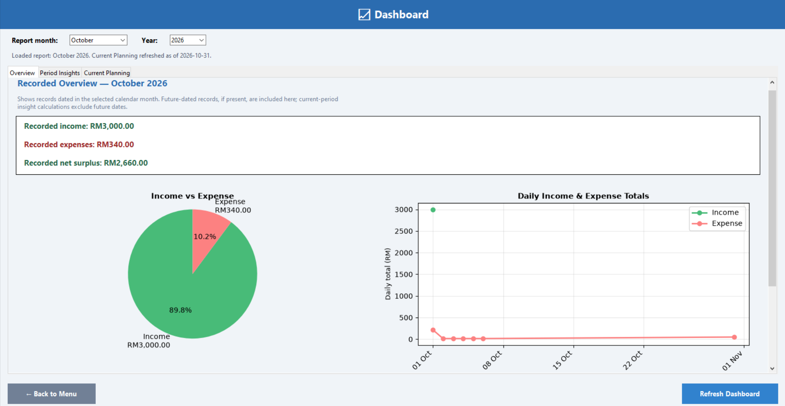
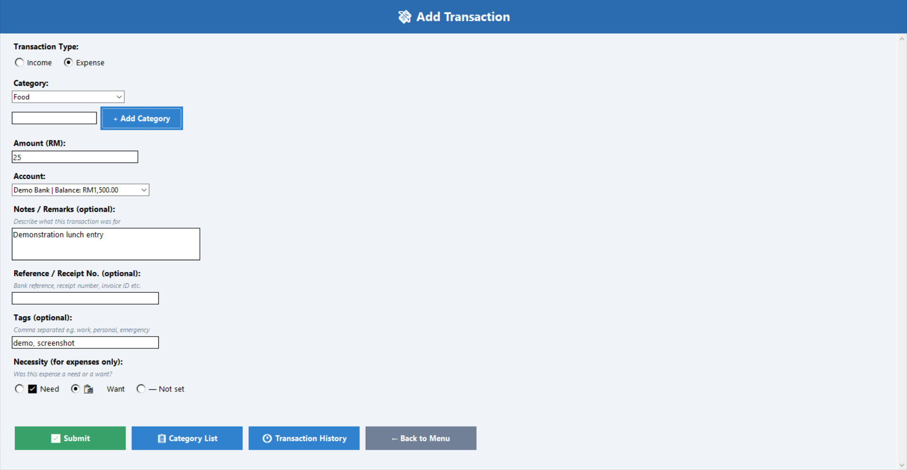
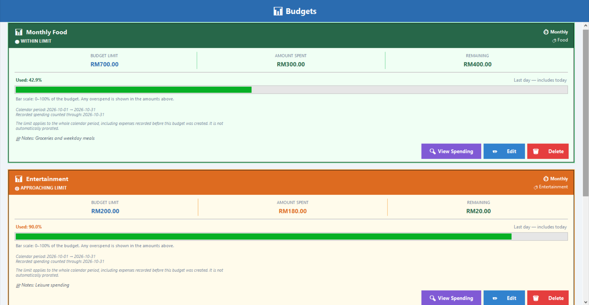
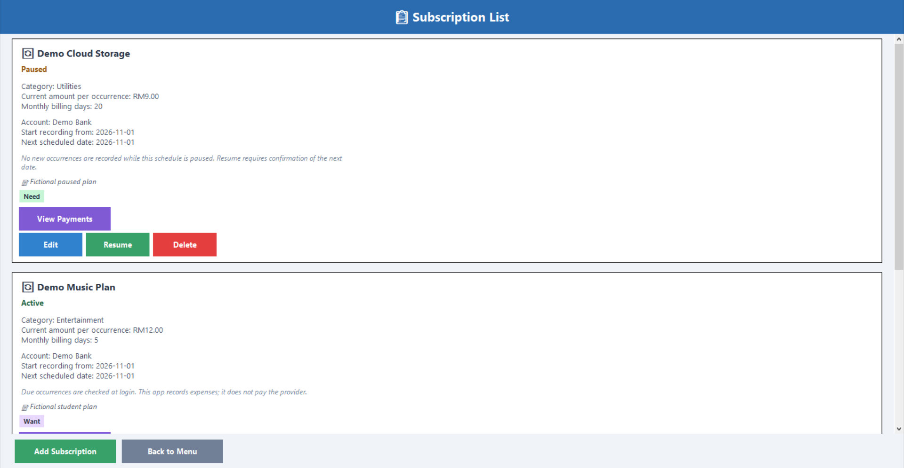
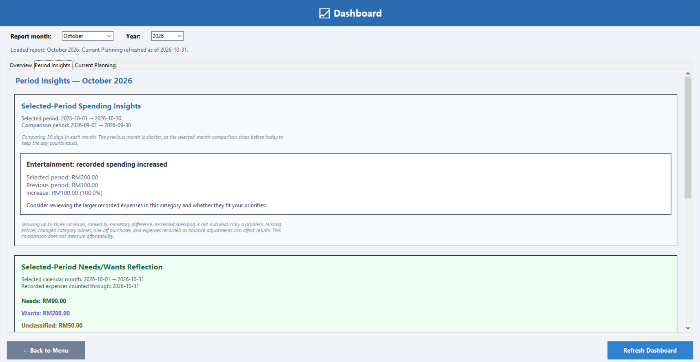
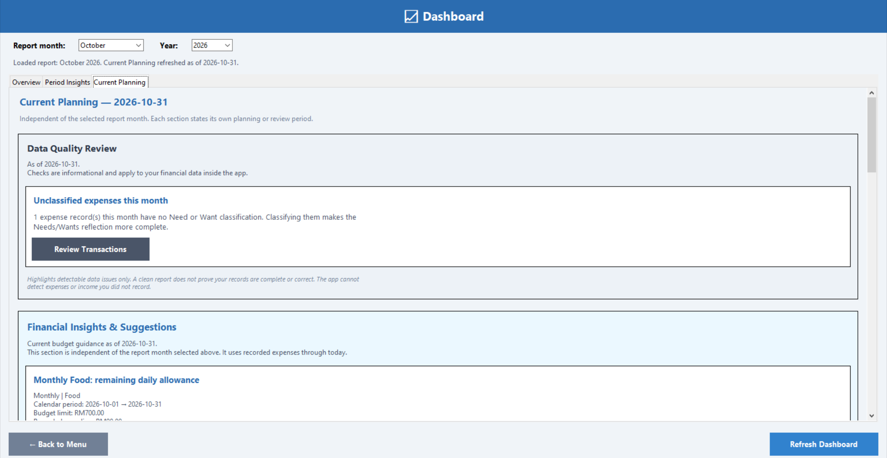
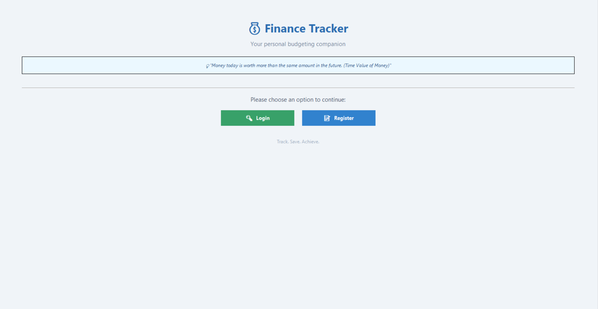
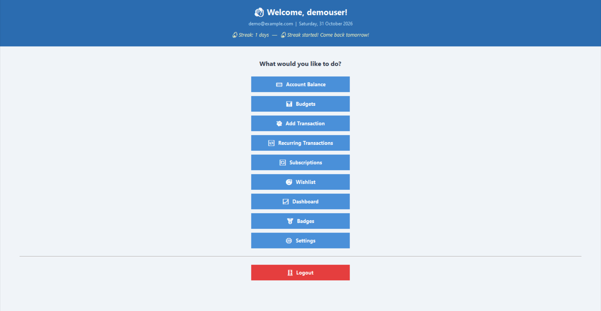
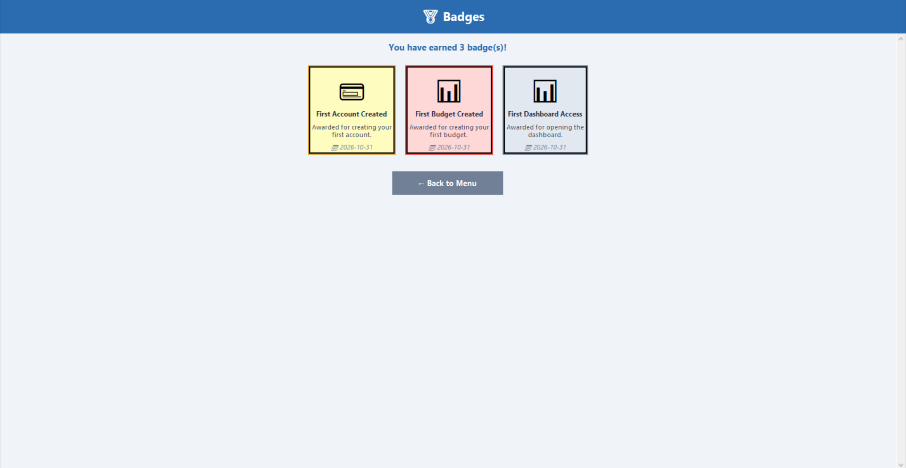

# 💰 Finance Tracker — Personal Budgeting App

A personal finance management system designed with Generation Z users
in mind and developed as a Final Year Project.

Originally prototyped in Google Colab with ipywidgets, the project was
subsequently developed into a local Python desktop application using
tkinter, with VSCode as the development editor.

---

## 📌 About

Finance Tracker combines everyday financial tracking with motivational
features such as login streaks, achievement badges, and wishlist goals.

Users manually record financial information and manage their accounts,
budgets, transactions, and scheduled expenses through a desktop interface.

This is an academic prototype. It is not a banking application, payment
service, or financial advisory platform.

---

## ✨ Key Features

| Feature | Description |
|---|---|
| 💳 Account Management | Track up to five financial accounts, edit names and notes, and record balance adjustments with a reason |
| 📊 Budget Tracking | Create category-based budgets with daily, weekly, monthly, or yearly calendar periods, spending breakdowns, notes, and alerts |
| 💸 Transactions | Add, edit, delete, and search income and expenses using categories, tags, notes, references, and Need/Want classification |
| 🔁 Recurring Transactions | Schedule income and expenses with login-based processing, missed-occurrence catch-up, history, and pause/resume controls |
| 🔄 Subscriptions | Manage subscription expenses through the shared recurring engine, including multiple monthly billing days and linked payment history |
| 🎯 Wishlist | Track virtual contributions toward purchase goals independently of account balances |
| 📈 Dashboard | View monthly transaction summaries and income/expense charts |
| 💡 Financial Insights | Explainable, rule-based suggestions covering budget allowances, spending changes, upcoming expenses, subscription commitments, and Needs/Wants reflection |
| 🏅 Badges and Streaks | Recognise usage milestones and consecutive-day logins |
| ⚙️ Currency Display | Select a display currency from 20 options, including USD, MYR, GBP, and EUR; amounts are not converted |
| 📥 CSV Export | Export transaction records to a CSV file |
| 🔒 Password Hashing | Store registered passwords as bcrypt hashes rather than plaintext |

---

## 🔁 How Scheduled Transactions Work

Subscriptions are specialised recurring expenses. The Subscriptions and
Recurring Transactions screens use the same underlying schedule rather
than independently generating expenses.

### Processing

- Active schedules are checked after a successful login.
- Creating a new subscription also triggers a check of the user's due schedules.
- Due occurrences are recorded using their scheduled dates.
- Missed occurrences are caught up when processing next runs.
- The application does not process schedules in the background while closed.
- Recording a scheduled expense updates the account balance stored inside the app.
- The application does not contact a bank, transfer money, or pay a provider.

### Subscription Billing

- Subscriptions support monthly billing days such as `1,15`.
- Duplicate billing-day input is normalised, so `15,1,15` becomes `1,15`.
- Days that do not exist in a month are skipped.
  For example, a schedule for the 31st has no occurrence in April.
- Annual subscription billing is not currently implemented.
- Older subscriptions require explicit account and recording-start-date
  setup before joining the shared scheduler.
- Setting up an older subscription does not immediately generate expenses.
  Due occurrences are checked at the next login.
- A past recording start date can create catch-up expenses. Review the
  confirmation carefully to avoid duplicating manually recorded payments.

### Duplicate Protection and History

- Each processed occurrence is identified by its recurring rule and scheduled date.
- Processed-occurrence records prevent repeated generation of the same occurrence.
- Deleting a generated transaction does not automatically regenerate it.
- History uses stored IDs, so renaming a schedule does not break its links.
- Transactions created before reliable schedule links were introduced may
  remain available only in normal Transaction History.
- History lists show surviving linked transactions, not a complete,
  immutable audit log.
- Users must still avoid creating two schedules for the same real-world payment
  or recording the same expense both manually and automatically.

### Editing, Pausing, and Deleting

- Linked subscription edits update the subscription and shared schedule together.
- Editing schedule settings does not rewrite past transactions or change balances.
- Linked subscription edits are blocked when an occurrence is due today
  or earlier until outstanding dates are resolved.
- Pausing stops automatic processing.
- Resuming requires confirmation of the next scheduled date.
- Pending dates before the confirmed resume date are skipped rather than
  automatically caught up.
- Deleting a linked subscription or its schedule removes both records,
  while preserving past transactions and account balances.
- Past expenses from deleted schedules remain accessible in normal
  Transaction History.

### Processing Errors

If scheduled processing fails during login, the user can still sign in.

The application displays a warning, and uncommitted changes from that
processing attempt are rolled back. Due occurrences may remain pending,
so balances and budget totals may not include them.

Do not manually add replacement expenses without first checking the
processing problem, because this could create duplicate records.

---

## 📅 How Budget Periods Work

Budgets use calendar periods:

| Timeframe | Period |
|---|---|
| Daily | Today |
| Weekly | Monday through Sunday |
| Monthly | First through last day of the current month |
| Yearly | 1 January through 31 December |

- Spending is counted from the period start through today.
- Future-dated transactions are excluded from current spending totals.
- The limit applies to the whole calendar period, including expenses
  recorded before the budget was created.
- Limits are not automatically prorated for budgets created mid-period.
- The Add Budget screen previews the current period before saving.
- Pay-cycle and custom-date budget periods are not currently implemented.

---

## 🗂️ Monthly Budget Settings History

Monthly budgets record month-level settings consisting of:

- The effective calendar month.
- The budget limit.
- The expense-category scope.

Changes apply to the current calendar month. Saving again in the same
month replaces that month's settings rather than creating an edit-by-edit
audit log.

Settings carry forward until a later recorded change. Earlier months
without recorded settings remain unknown; the app does not reconstruct
them from current values.

The Dashboard reviews the three most recent completed months using each
month's applicable recorded settings. A review suggestion is triggered
when at least two months with known settings are above their applicable
limits. This threshold is an application rule, not a financial standard.

Each month with known settings provides a read-only expense drill-down.
It uses that month's recorded category scope, rather than the budget's
current category.

### Boundaries

- History currently applies to monthly budgets only.
- Monthly budgets with history cannot be changed to another timeframe.
- Historical spending is calculated from transactions as they exist now.
  Editing or deleting transactions can change earlier totals.
- Months without recorded settings are excluded from historical-limit
  comparisons, not treated as zero spending.
- Deleting a budget permanently deletes its settings history but preserves
  transactions and account balances.
- Deleted budgets are not archived for later review.

---

## 💡 Financial Insights and Recommendations

The Dashboard includes a knowledge-based recommendation module.
It applies explicit rules to recorded financial information and explains
the observations and calculations behind its suggestions.

### Selected-Period Insights

These follow the month and year selected in the Dashboard:

- **Category spending comparison:** highlights up to three category
  spending increases, ranked by monetary difference.
- **Needs/Wants reflection:** shows Needs, Wants, and unclassified expense
  totals. Percentages use classified expenses only—not income.
- **Repeated spending review:** highlights up to three categories with
  at least five positive expense entries, ranked by recorded total.
  The threshold is an application rule, not evidence of impulse buying
  or unnecessary spending.

For the current month, category comparisons use matched elapsed-day
ranges against the previous month. If the previous month is shorter,
the comparison cutoff is limited to keep the day counts equal.
Completed months are compared as full calendar months, with their
different lengths disclosed.

### Current Guidance

These use the current date, independently of the selected report month:

- **Daily budget allowance:** divides the remaining calendar-period
  budget by remaining days, including today. Reached or exceeded limits
  produce spending-review guidance instead.
- **Upcoming scheduled expenses:** groups unprocessed active expense
  occurrences due over seven calendar days, including today, by account.
  It compares them with current recorded account balances.
- **Subscription cost review:** estimates unprocessed subscription
  expenses scheduled for the next calendar month using current active
  schedule settings and prices.
- **Data-quality review:** highlights selected detectable issues, such as
  unclassified expenses, invalid budget limits, and incomplete schedule links.
  Some conditions are review prompts rather than proof of incorrect data.
- **Historical monthly budget review:** compares the three most recent
  completed months with their applicable recorded monthly limits and
  category scopes. Months without known settings are excluded.

### Important Interpretation

- Recommendations do not generate transactions, change balances,
  reserve funds, or automatically modify budgets.
- Guidance refreshes when the Dashboard opens or Refresh Dashboard is clicked.
- Missing records, user-supplied classifications, category-name changes,
  and balance adjustments can affect results.
- Invalid amounts and unevaluable schedules are excluded where detected,
  with notices explaining the exclusions.
- Unclassified expenses are not treated as Wants.
- Needs/Wants percentages must not be compared directly with the
  50/30/20 income-allocation guideline.
- Scheduled-expense guidance is not a complete cash-flow forecast:
  it does not include all future income, spending, or balance changes.
- Budget allowances can overlap, and subscription commitments can appear
  in more than one planning horizon. Do not add overlapping figures together.
- Increased spending does not automatically indicate a problem, and the
  app does not know whether a subscription is unused.

### Approach and Evaluation

This is an explainable, rule-based knowledge system—not machine learning,
case-based reasoning, emotional analysis, or automatic impulse-purchase
detection.

Temporary-database calculation tests and combined Dashboard workflow
checks have passed for the implemented scenarios, including a check
that viewing insights leaves transaction counts and balances unchanged.

These checks do not establish that the recommendations improve savings,
financial literacy, or long-term financial behaviour. Those outcomes
require separate user research.

The recommendation module was added to the desktop implementation after
the original Colab prototype. It was not part of the original prototype's
reported user testing.

---

## 🖥️ Dashboard Layout

The Dashboard separates financial reporting and guidance into three tabs.

| Tab | Contents |
|---|---|
| Overview | Selected-month recorded totals, charts, and transaction table |
| Period Insights | Category spending comparison, Needs/Wants reflection, and repeated spending review |
| Current Planning | Data-quality review, current budget allowances, upcoming expenses, subscription costs, and historical monthly budget review |

### Report Selection and Refresh

- Month and year controls remain outside the scrolling content.
- Overview and Period Insights follow the loaded report selection.
- Changing the selection requires clicking Refresh Dashboard.
- Current Planning uses today's date and each section's stated time window,
  independently of the selected report month.
- Back to Menu and Refresh Dashboard remain in a fixed bottom bar.
- Each tab has a separate scrollable area.

### Charts

- The pie chart shows the income/expense split in the selected records.
  It is not a savings-rate chart or an assessment of financial health.
- The line chart aggregates transactions into daily income and expense totals.
- Multiple transactions on the same date are combined into one daily point
  for each applicable series.
- Days without entries for a series are not explicitly plotted as zero.
  Lines connect the available daily points.
- A series with records on only one date appears as a single point.
- Overview includes records dated in the selected month, including
  future-dated records if present. Current-period insight calculations
  exclude future dates according to their stated rules.

### History Windows

Budget spending, recurring history, and subscription expense history use
the shared scrollable-frame helper.

These windows support scrolling over cards and labels, resizing, and
closing through the Close button, Escape, or the window close control.

Subscription history displays recorded expenses, not verified payments
to a provider.

---

## 🛠️ Built With

| Tool | Purpose |
|---|---|
| Python | Core programming language; current development environment uses Python 3.14 |
| tkinter | Desktop graphical interface |
| SQLite | Local database storage |
| matplotlib | Financial charts and visualisation |
| pandas | Tabular data handling and CSV export |
| bcrypt | Password hashing |
| python-dateutil | Date calculations for budgets and recurring schedules |
| VSCode | Development editor |
| Git and GitHub | Version control and repository hosting |

---

## 🚀 How to Run

### Requirements

- Developed and manually tested on Windows using Python 3.14.
- Compatibility with other Python versions and operating systems has not
  yet been fully verified.
- A Python installation with working tkinter support.
- Third-party libraries listed in `requirements.txt`.

### Installation Verification

The dependencies in `requirements.txt` were successfully installed in a
clean Python 3.14 virtual environment on Windows.

Verification included:
- `pip check` reporting no broken requirements.
- Successful imports of the required libraries.
- A temporary-database smoke test covering registration, login, account
  creation, transaction entry, dashboard charts, and the subscription form.

This verifies the tested Windows/Python environment. It does not establish
compatibility with every operating system or Python version.

### 1. Clone the Repository

```bash
git clone https://github.com/Foundnationz/finance-tracker.git
cd finance-tracker
```

### 2. Create a Virtual Environment

On Windows:

```powershell
python -m venv .venv
```

### 3. Install Dependencies

Use the virtual environment's Python directly; activation is not required:

```powershell
.\.venv\Scripts\python.exe -m pip install -r requirements.txt
```

### 4. Run the Application

```powershell
.\.venv\Scripts\python.exe capstone_project_code.py
```

The application creates `budgeting_app.db` automatically in the same
folder as the Python application file on first run.

You do not need to create the database manually.

---

## 🖥️ Screenshots

The screenshots below use fictional demonstration data.
Some views show only a representative portion of a scrollable screen.

### Dashboard — Overview

Selected-month totals, daily income/expense charts, and transaction records.



### Add Transaction

Record income or expenses with an account, category, notes, references,
tags, and expense classification.



### Budget Tracking

Calendar-based budgets with recorded spending, remaining or exceeded
amounts, and access to contributing transactions.



### Subscription Management

Linked subscription schedules with billing days, account information,
next scheduled dates, and active/paused controls.



### Dashboard — Period Insights

Analysis tied to the selected report month, including spending comparisons,
Needs/Wants reflection, and repeated spending review.



### Dashboard — Current Planning

Current-date guidance for budget allowances, scheduled expenses,
subscription commitments, data quality, and historical budget review.



<details>
<summary>Additional screenshots: Welcome, Main Menu, and Badges</summary>

### Welcome Screen



### Main Menu



### Badges



</details>

---


---

## 📂 Project Structure

```text
finance-tracker/
├── capstone_project_code.py   # Main desktop application
├── requirements.txt           # Third-party Python dependencies
├── README.md                  # Project overview and instructions
├── CONTRIBUTING.md            # Guidelines for contributors
├── .gitignore                 # Files excluded from version control
├── docs/                      # Academic project report
└── assets/
    └── screenshots/           # Demonstration screenshots
```

The local database and virtual environment are runtime/development files.
They should not be committed to the repository.

---

## 🔑 Developer Utilities and Local Data

The source includes developer helpers for listing registered users and
deleting test users.

User deletion requires confirmation and permanently removes the selected
user's associated records. These helpers are maintenance utilities,
not a secured administrative dashboard.

Do not run deletion utilities against real data without a backup.

### Database Safety

- `budgeting_app.db` contains local user and financial data.
- Keep the database, SQLite sidecar files, backups, and real financial
  exports out of version control.
- Password hashing does not encrypt the SQLite database or its financial records.
- Anyone who can access the database file may be able to read its contents.
- Close the application before making a simple file-copy backup.
- To start fresh, close the app and move the database to a secure backup
  location before rerunning. A new database will be created automatically.
- Moving or deleting the database does not remove copies already present
  in Git history, backups, or cloud storage.

### Recommended Local-Only Files

Your `.gitignore` should exclude local files such as:

```gitignore
# Local SQLite databases and sidecar files
*.db
*.db-journal
*.db-wal
*.db-shm

# Virtual environments
.venv/
venv/
env/

# Python caches
__pycache__/
*.py[cod]
```

Backups and exports containing real information should also be stored
outside the repository or explicitly ignored.

Adding a file to `.gitignore` does not stop tracking a file that was
already committed. Removing sensitive information from Git history
requires separate action.

---

## 🧪 Testing

### Run the Saved Automated Tests

From the repository's main folder on Windows:

```powershell
.\.venv\Scripts\python.exe -m pip install -r requirements-dev.txt
```

```powershell
.\.venv\Scripts\python.exe -m pytest -q
```

The saved suite covers selected scenarios involving:

- Calendar and subscription billing-date calculations.
- Database setup, foreign-key enforcement, and repeated initialisation.
- Scheduled transaction generation and duplicate prevention.
- Monthly budget settings history and historical category scope.
- Core budget-allowance, category-comparison, and Needs/Wants calculations.

Database tests use a fixture that redirects the application's database
path to a pytest temporary directory. These tests must request the
`temporary_app` fixture before accessing application database functions.

The saved tests do not open the Tkinter interface. GUI navigation,
scrolling, chart rendering, and other interactive behavior require
separate manual checks.

This is a growing regression suite, not complete application coverage.

### Additional Development Checks

Development checks have included temporary-database tests and manual
GUI workflow checks covering:

- Fresh database creation and repeated setup.
- Subscription creation and shared-schedule linking.
- Scheduled expense recording and account-balance updates.
- Repeated-login duplicate prevention.
- Missed-occurrence catch-up.
- Multiple monthly billing days and leap-year date handling.
- Separation of subscription payment history from unrelated category expenses.
- Linked subscription editing without rewriting past transactions.
- Pause/resume confirmation and next-date selection.
- Deletion from either linked screen while preserving past transactions.
- Explicit setup of older, unlinked subscriptions.
- User-data deletion in dependency order.
- Login warnings when scheduled processing fails.
- Calendar budget-period boundaries, including short months and leap years.
- Unified budget spending totals across cards, alerts, and breakdowns.
- Recommendation calculations for allowances, spending comparisons,
  upcoming expenses, subscription costs, and Needs/Wants reflection.
- Combined Dashboard refresh behavior and read-only operation.

A clean-environment installation and application smoke test have passed
on Windows using Python 3.14.

These checks provide evidence for the tested scenarios.
They do not establish that the application is free of bugs,
production-ready, or suitable for regulated financial services.

Broader automated coverage, platform testing, and verification of
additional edge cases remain areas for improvement.

---

## ⚠️ Current Limitations

- Financial information is entered manually; there is no live bank or
  e-wallet integration.
- Scheduled processing requires application activity and is not a
  background payment service.
- Subscription scheduling currently uses monthly billing-day patterns,
  not annual subscription plans.
- Budgets use calendar periods only; pay-cycle and custom-date periods
  are not implemented.
- Currency selection changes display settings without exchange-rate conversion.
- Wishlist funding is a virtual goal tracker. It does not reserve or
  transfer money, support target dates, or calculate contribution plans.
- Dashboard recommendations use explicit rules, not AI models or
  case-based reasoning. Their financial or behavioural effectiveness
  has not been established through a dedicated user study.
- Financial educational quotes are randomly selected rather than
  personalised to the user's circumstances.
- Password hashing protects passwords differently from database encryption;
  financial records are not encrypted by this mechanism.
- Transactions are editable and deletable, so the application does not
  provide an immutable financial audit trail.
- Compatibility, accessibility, large-data performance, and security
  require further evaluation.
- The current codebase remains primarily a single application file.
  Further modularisation would improve maintainability.

---

## 📄 Project Report and Development Update

The submitted academic project report is available in the
[`docs/`](docs/) folder and is retained unchanged as a historical record.

It primarily documents the original Google Colab prototype and includes
proposed capabilities that were not all implemented.

Later desktop changes are documented separately in the
[Post-Submission Desktop Implementation Update](docs/desktop-implementation-update.md).

The desktop recommendation module was added after the original prototype.
It was not part of the original prototype's reported user acceptance testing.

The update document is a development record, not an official amendment
to the submitted academic report.

---


---

## 🔄 Development History

The labels below describe project development stages; they do not
necessarily correspond to published GitHub releases.

| Stage | Environment | Description |
|---|---|---|
| v1.0 | Google Colab + ipywidgets | Original academic prototype |
| v2.0 | Local Python desktop app + tkinter | Developed using VSCode, with GUI migration and functional improvements |

### Desktop Implementation Improvements

- Replaced notebook widgets with a tkinter desktop interface.
- Added bcrypt password hashing.
- Expanded transaction records with tags, notes, references, and Need/Want.
- Added editing across major management sections.
- Added recurring income and expense processing.
- Unified subscription scheduling with the recurring engine.
- Added ID-linked recurring and subscription history.
- Added processed-occurrence tracking for duplicate protection.
- Added explicit schedule setup for older subscriptions.
- Added confirmed pause/resume dates.
- Added clearer schedule-processing failure warnings.
- Added selectable currency display without exchange-rate conversion.
- Added CSV export.
- Added consistent calendar budget periods across cards, alerts, and breakdowns.
- Added budget spending breakdowns and clearer monetary alerts.
- Added budget notes and shared category creation.
- Added balance adjustments recorded as transactions with a reason.
- Added explainable Dashboard budget-allowance recommendations.
- Added selected-period category spending comparisons and Needs/Wants reflection.
- Added upcoming scheduled-expense guidance grouped by account.
- Added next-calendar-month subscription cost reviews.
- Tested the combined insights display for refresh behavior and read-only operation.
- Improved developer user-data cleanup.

---

## 👥 Authors and Contributions

This application originated as a joint Final Year Project by
**Shawn** and **Farrel**, focused on a financial tracker, budgeting,
and coaching concept for Generation Z.

The original project was developed before this GitHub repository was
established. The repository's commit history therefore does not represent
the full history or division of work on the original project.

### Farrel — Original Concept and Prototype Implementation

Farrel's contributions included:

- Formulating the main FYP title and initial financial tracker,
  coaching, and budgeting concept for Generation Z.
- Implementing the original Google Colab application codebase,
  including database setup and application functionality.
- Performing administrator-side application testing.
- Jointly developing ideas for the application's end-to-end behavior
  and feature workflows.
- Applying final formatting and structural presentation improvements
  to the academic report.

Farrel does not currently have a GitHub profile linked to this project.

### Shawn — Design, Report, Testing, and Desktop Development

[Shawn (@Foundnationz)](https://github.com/Foundnationz) contributed:

- Ideas for application improvements and user-facing functionality.
- User-side application testing.
- Joint development of the application's end-to-end behavior
  and feature workflows.
- Use case diagrams, activity diagrams, and other system-design materials.
- Most of the academic report's written content.
- Post-submission development and maintenance of the desktop application,
  including its migration from the Colab prototype and subsequent
  enhancements documented in this repository.

### AI-Assisted Development Disclosure

The post-submission desktop development used OpenAI ChatGPT for
code suggestions, explanations, debugging guidance, testing examples,
and documentation drafting.

Shawn applied and tested changes during this development process.
This assistance does not replace or diminish Farrel's authorship of
the original prototype or the contributors' joint work on the FYP.

### Contributing

For guidance on reporting issues or proposing changes, see
[CONTRIBUTING.md](CONTRIBUTING.md).

---

## 🎓 Academic Context

| Detail | Information |
|---|---|
| Project Type | Final Year Project |
| Intended Audience | Generation Z users |
| Methodology | Agile-inspired iterative development within an SDLC framework |
| Focus Area | Personal Finance Management |
| Current Application Type | Local desktop prototype |